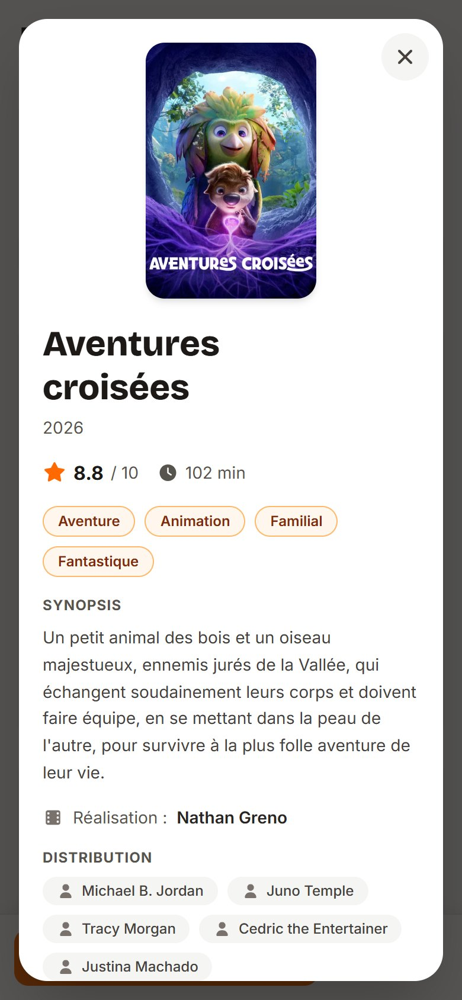
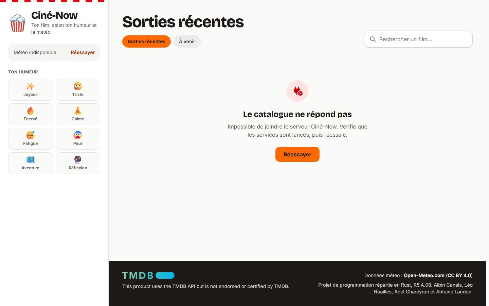
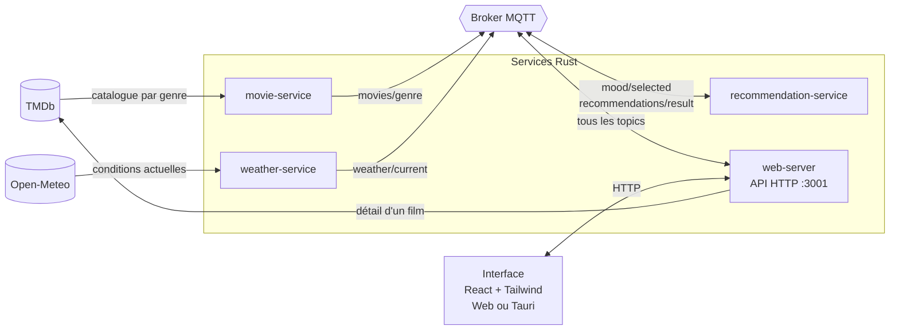
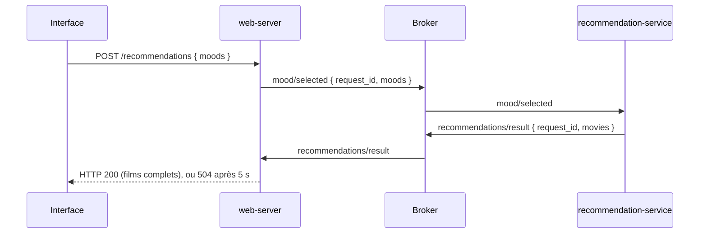

# 🍿 Ciné-Now

**Une application qui recommande le bon film selon ton humeur et la météo du moment.**
Quatre microservices Rust dialoguent en MQTT derrière une interface React, disponible sur le web et en application de bureau Tauri.


| Mobile | Fiche film | API coupée |
|---|---|---|
|  |  |  |

## Stack

| Couche | Technologies |
|---|---|
| Backend | Rust, Tokio, axum, rumqttc, reqwest |
| Messagerie | MQTT (Eclipse Mosquitto en Docker, Shiftr Desktop en local) |
| Interface | React 19, Tailwind CSS 4, Vite 7 |
| Bureau | Tauri 2 |
| Données | API TMDb (films), API Open-Meteo (météo) |
| Déploiement | Docker Compose, nginx |

## Démarrage rapide

Prérequis : Docker et une [clé API TMDb gratuite](#5-clé-api-tmdb-gratuite).

```bash
cp .env.example .env     # puis renseigner TMDB_API_KEY
docker compose up -d --build
```

L'application est sur **http://localhost:8080**. Le catalogue se remplit en une trentaine de secondes au premier lancement.

| Commande | Effet |
|---|---|
| `docker compose logs -f` | Suivre les journaux des services |
| `docker compose exec mqtt mosquitto_sub -t 'mood/selected' -t 'recommendations/result' -v` | Observer les messages MQTT en direct |
| `docker compose down` | Tout arrêter |

Les ports `8080` (interface), `3001` (API) et `1883` (MQTT) doivent être libres. Ils ne sont exposés que sur `127.0.0.1`. Pour viser une autre API, définir `VITE_API_URL` dans `.env` : la variable est figée au build de l'interface.

## Architecture

Chaque service tourne dans son propre conteneur et ne connaît que le broker. Seul le `web-server` parle à l'interface.



## Points techniques marquants

**Scoring contextuel.** Chaque film reçoit `note TMDb × multiplicateur(humeur, météo, moment de la journée)`. Les règles couvrent 8 humeurs et 6 familles de météo : par exemple, peur + soleil oriente vers la comédie, peur + nuit d'orage vers le thriller. Les films hors contexte gardent un score réduit (× 0,7), plusieurs humeurs se combinent en retenant le meilleur score, et un plafond de 4 films par genre garde un top 20 varié. Voir [`recommendation-service/src/lib.rs`](services/recommendation-service/src/lib.rs).

**HTTP synchrone sur un bus asynchrone.** Le navigateur attend une réponse HTTP alors que le calcul passe par deux échanges MQTT. Le `web-server` attribue un `request_id`, gare un canal `oneshot` et répond dès que le message portant le même identifiant revient, ou renvoie `504` après 5 s. Deux utilisateurs simultanés reçoivent ainsi chacun leur résultat, sans attente arbitraire ni résultat périmé. Voir [`web-server/src/main.rs`](services/web-server/src/main.rs).



**Découplage par messages retained.** Météo et catalogue sont publiés en `retained` : l'ordre de démarrage n'a pas d'importance, et un service qui redémarre retrouve l'état courant dès sa souscription.

**Tests.** 39 tests Rust vérifient les pondérations, la diversification, le catalogue vide, la traduction des codes météo et la reconstitution des résultats. Le parcours complet a aussi été vérifié dans Chrome, du mobile au desktop, avec une vraie coupure de l'API et un audit d'accessibilité axe-core.

**Interface soignée.** Squelettes de chargement, états d'erreur et états vides distincts, navigation complète au clavier, fiche film en `<dialog>` natif (Échap, focus piégé puis restitué), contrastes AA et respect de `prefers-reduced-motion`.

## Équipe et contexte

Projet de Programmation Répartie en Rust, module R5.A.08, IUT, groupe Info3-TP1K.

- Albin CANALS
- Léo NOAILLES
- Abel CHAREYRON
- Antoine LANDON

## Ma contribution

> ✍️ *Section à rédiger par Léo.*

<!-- Décrire ici la contribution personnelle : services, fonctionnalités, décisions techniques. -->

---

## 📖 Spécifications

### Données utilisées en entrée

**Depuis l'interface :**
- Humeur sélectionnée (joie, tristesse, colère, peur, fatigue, calme, aventure, réflexion)

**Depuis l'API météo (Open-Meteo) :**
- Température actuelle (°C)
- Condition météorologique (pluie, soleil, nuageux, neige, orage...)
- Heure de la journée (matin, après-midi, soir, nuit)

**Depuis l'API films (TMDb) :**
- Titre, synopsis, genres, note, affiche, acteurs, réalisateur, durée, date de sortie

### Traitements réalisés

- Algorithme de scoring : chaque film reçoit un score basé sur `rating × multiplicateur(humeur, météo)`
- Diversification : maximum 4 films par genre dans le top 20
- Géocodage inversé des coordonnées GPS en nom de ville

### Données enregistrées

- Catalogue de films par genre (en mémoire, via MQTT retained)
- Météo actuelle (en mémoire, mise à jour toutes les 15 min)

### Données présentées à l'utilisateur

- Conditions météo en temps réel (icône animée, température, ville, géolocalisation)
- Catalogue de films avec sorties récentes et à venir
- Recommandations personnalisées selon l'humeur et la météo
- Détails complets d'un film (synopsis, acteurs, réalisateur, durée)

---

## 🏗️ Détails d'architecture

### Choix technologiques

**IPC : MQTT**
Choisi pour sa légèreté, son modèle publish/subscribe adapté aux événements et sa simplicité de déploiement. L'ordre de démarrage des services n'est pas critique grâce aux messages retained.

**Interface : Tauri**
Choisi pour son intégration native avec Rust, sa légèreté comparée à Electron, et la possibilité de créer une interface web moderne (React) tout en bénéficiant d'un exécutable natif.

### Topics MQTT

| Topic | Publié par | Souscrit par | Description |
|---|---|---|---|
| `weather/current` | weather-service | web-server, recommendation-service | Météo actuelle |
| `weather/location` | web-server | weather-service | Coordonnées GPS |
| `movies/{genre}` | movie-service | web-server, recommendation-service | Catalogue par genre |
| `mood/selected` | web-server | recommendation-service | `request_id` + humeurs sélectionnées |
| `recommendations/result` | recommendation-service | web-server | `request_id` + IDs et scores recommandés |

### Routes HTTP (web-server, port 3001)

| Méthode | Route | Description |
|---|---|---|
| GET | `/weather` | Météo actuelle |
| GET | `/movies` | Catalogue complet par genre |
| GET | `/movie/:id` | Détails complets d'un film (fetch TMDb à la demande), `404` ou `502` en cas d'échec |
| POST | `/recommendations` | Envoie les humeurs et renvoie les films recommandés, `504` si le service ne répond pas |
| POST | `/location` | Envoyer les coordonnées GPS |

---

## 🚀 Installation sans Docker

Pour développer sur les services ou lancer l'application de bureau Tauri.

> ⚠️ Sur Windows, Smart App Control bloque les binaires Rust non signés : `cargo run` et `tauri dev` échouent quand il est activé. Utiliser alors [Docker Compose](#démarrage-rapide).

### Prérequis

#### 1. Rust (version 1.75 ou supérieure)
- **Windows** : https://rustup.rs/
- **Linux/Mac** :
  ```bash
  curl --proto '=https' --tlsv1.2 -sSf https://sh.rustup.rs | sh
  ```
  Sur les machines IUT, utiliser une version locale :
  ```bash
  export RUSTUP_HOME=~/.rustup
  rustup install stable
  ```

#### 2. Node.js (v18 ou supérieure)
- https://nodejs.org/

#### 3. Shiftr Desktop (broker MQTT)
- https://www.shiftr.io/desktop#downloads
- Interface de monitoring : http://localhost:3000
- Port MQTT : 1883

#### 4. Dépendances système Linux (pour Tauri)

Les dépendances suivantes sont le minimum requis, d'autres peuvent être nécessaires selon la distribution :

```bash
sudo apt update
sudo apt install \
  build-essential \
  pkg-config \
  libssl-dev \
  libglib2.0-dev \
  libgdk-pixbuf-2.0-dev \
  libpango1.0-dev \
  libatk1.0-dev \
  libgtk-3-dev \
  libwebkit2gtk-4.1-dev
```
> ⚠️ Sur Windows ces dépendances ne sont pas nécessaires (WebView2 intégré).

#### 5. Clé API TMDb (gratuite)
1. Créer un compte : https://www.themoviedb.org/signup
2. Aller dans **Settings → API → Request an API Key**
3. Choisir **Developer**, remplir le formulaire (Education/Student)
4. Copier la **API Key (v3 auth)**

### Configuration

1. Cloner le dépôt :
```bash
git clone https://gitlab.iut-valence.fr/canalsal/r5.a_08-cinenow.git
cd r5.a_08-cinenow
```

2. Copier et configurer le fichier d'environnement :
```bash
# Linux/Mac
cp .env.example .env

# Windows
Copy-Item .env.example .env
```

3. Remplir `.env` avec votre clé TMDb

4. Compiler le projet :
```bash
cargo build
cd ui && npm install
```

---

## ▶️ Lancement sans Docker

### Mode développement

1. Lancer **Shiftr Desktop**
2. Exécuter le script :

**Windows** — lance les services ET l'interface Tauri automatiquement :
```powershell
.\scripts\run-dev.ps1
```

**Linux** — lance uniquement les services Rust :
```bash
chmod +x scripts/run-dev-linux.sh
./scripts/run-dev-linux.sh
```

> ⚠️ Sur Linux, l'interface Tauri doit être lancée manuellement après avoir installé les dépendances système (voir prérequis) :
> ```bash
> cd ui && npm run tauri dev
> ```

Ou manuellement dans des terminaux séparés (dans cet ordre) :
```bash
cargo run -p weather-service
cargo run -p movie-service
cargo run -p recommendation-service
cargo run -p web-server
cd ui && npm run tauri dev
```

### Mode release

1. Lancer **Shiftr Desktop**
2. Exécuter le script :

**Windows** — compile tout, lance les services et ouvre le dossier pour lancer l'exe Tauri :
```powershell
.\scripts\run-release.ps1
```

**Linux** — compile et lance uniquement les services Rust :
```bash
./scripts/run-release-linux.sh
```

> ⚠️ Sur Linux, lancer ensuite l'interface manuellement :
> ```bash
> cd ui && npm run tauri build  # si pas encore compilé
> ./ui/src-tauri/target/release/CineNow
> ```

3. **Windows** : Double-cliquer sur l'exe **Ciné-Now** dans le dossier `target/release/` qui s'ouvre automatiquement.

---

## 🧪 Tests

```bash
# Tous les tests (unitaires + intégration), Tauri compris
cargo test

# Par service
cargo test -p weather-service
cargo test -p recommendation-service
cargo test -p web-server

# Tests d'intégration uniquement
cargo test -p weather-service --test integration-test
cargo test -p recommendation-service --test integration-test

# Tests unitaires uniquement
cargo test -p weather-service --lib
cargo test -p recommendation-service --lib
```

Sans Rust installé, ou si Smart App Control bloque les binaires de test, lancer les tests des services dans un conteneur (hors Tauri, dont les dépendances système ne sont pas dans l'image) :

```bash
docker run --rm -v "${PWD}:/src:ro" -w /src -e CARGO_TARGET_DIR=/tmp/target rust:1 \
  cargo test --locked -p shared -p weather-service -p movie-service -p recommendation-service -p web-server
```

---

## 📚 Documentation

- [Cahier des charges](docs/cahier_des_charges.md)
- [Architecture](#architecture) et [détails d'architecture](#️-détails-darchitecture)

## Attribution

This product uses the TMDB API but is not endorsed or certified by TMDB. Données météo : [Open-Meteo.com](https://open-meteo.com/) ([CC BY 4.0](https://creativecommons.org/licenses/by/4.0/)).
